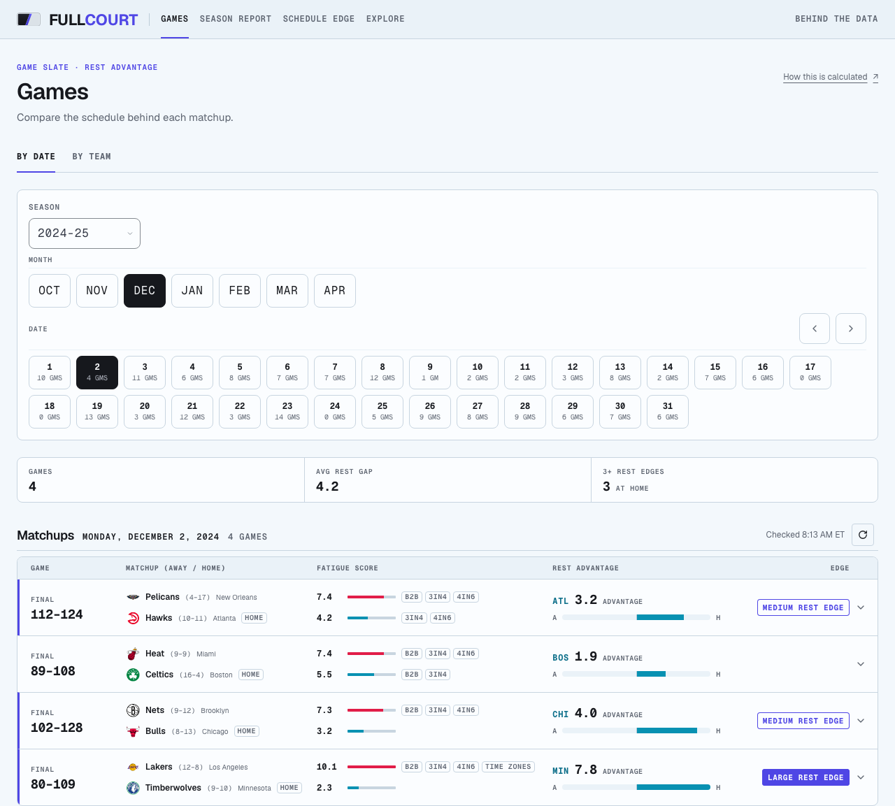

# FullCourt

NBA rest and schedule analysis, player shooting splits, and source-linked officiating reports.

**[Live app](https://fullcourt.fyi)** · [Methods](https://fullcourt.fyi/behind-the-data) · [Data status](https://fullcourt.fyi/data-status)

Compare schedule load before a matchup, inspect historical rest results, or explore shooting, shot location, player availability and NBA Last Two Minute reports. No account is needed; selected views can be shared by URL.



Screenshots show historical data. [Capture details](docs/screenshots/README.md).

## Engineering decisions

- The fatigue engine scores recent workload, travel, schedule density and recovery on the write path. Pages read stored scores; model changes require evidence beyond fitting the same backtest.
- Rest results separate the more-rested team at home from rested visitors and compare each with its venue baseline. These are historical associations, not causal effects or a complete game forecast.
- Independent analyses publish generated artifacts, with producing scripts and contract tests. [Data status](https://fullcourt.fyi/data-status) distinguishes module coverage and refresh dates from database connectivity.

Next.js · React · TypeScript · PostgreSQL / Drizzle · Python / scikit-learn · Vercel · GitHub Actions

## Run locally

Use Node 24 and the pnpm version pinned in `package.json`.

```bash
pnpm install --frozen-lockfile
cp .env.example .env.local
# Configure DATABASE_URL for a populated database.
pnpm dev
```

Database-backed pages require data. There is no automatic database bootstrap, and the ORM schema is deliberately incomplete: follow the [database guide](docs/DATABASE.md), rather than running `drizzle-kit push` or `generate`.

The [documentation index](docs/README.md) covers architecture, ingestion and analyses. See [verification](docs/TESTING_AND_CICD.md) for the release gate and database-backed browser checks.

## Reading the results

Coverage varies by module and season. Travel is inferred from game locations; some older schedule inputs are unavailable. Shooting splits can be noisy, shot-value models observe location rather than defender pressure, and L2M reports cover selected close-game endings. The [methods](https://fullcourt.fyi/behind-the-data) keep these limits beside the findings.

[Release history](CHANGELOG.md) · [Architecture decisions](docs/adr/) · [Research](docs/research/README.md)

## Credits and license

Built by [Michael Ju](https://github.com/mhju0).

The interface bundles Geist and Geist Mono locally under the
[SIL Open Font License 1.1](src/app/fonts/Geist-Variable-OFL.txt);
[font provenance](src/app/fonts/Geist-Variable-PROVENANCE.md) records official sources and hashes.
The separate static Geist fonts used for social images retain their
[original license](src/app/fonts/OFL.txt).

Copyright (c) 2026 Michael Ju. All rights reserved. No license is granted for use, copying,
modification, or distribution of this code. The repository is public for portfolio review.
