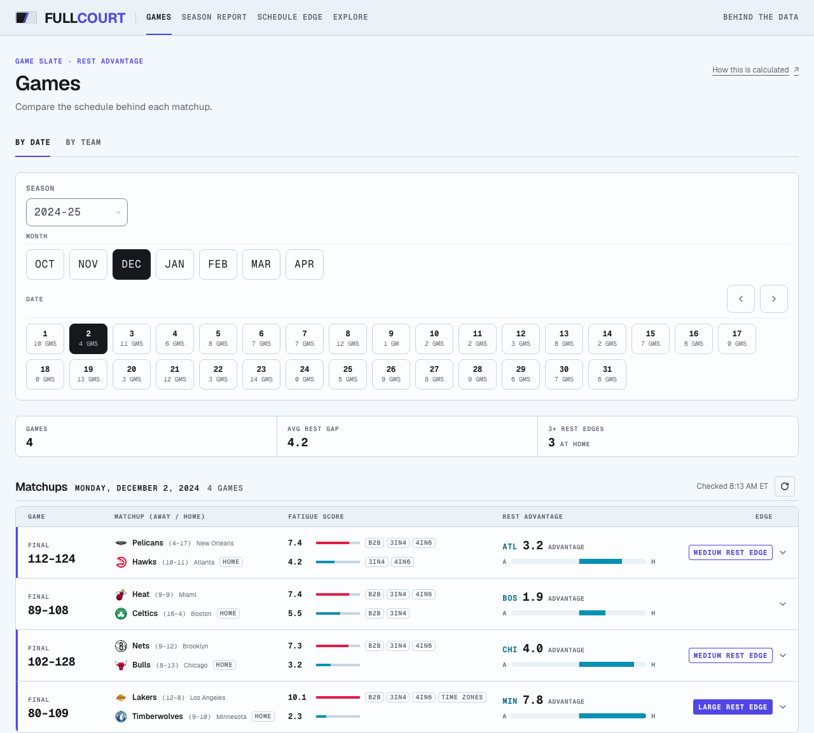
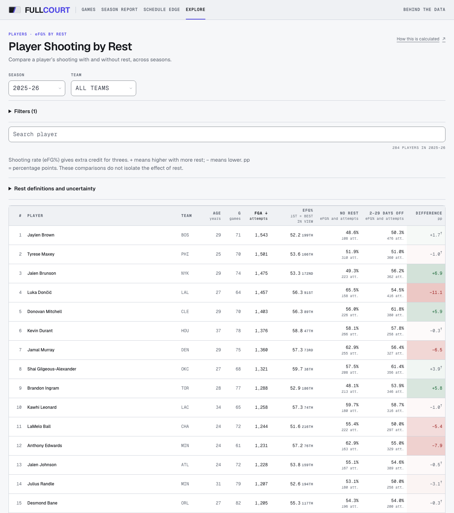
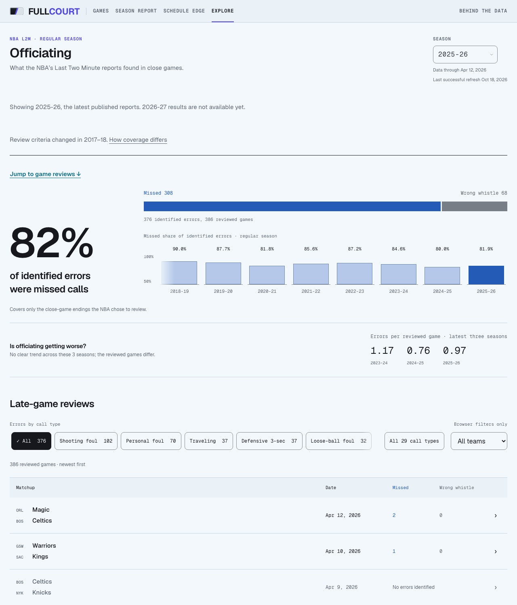
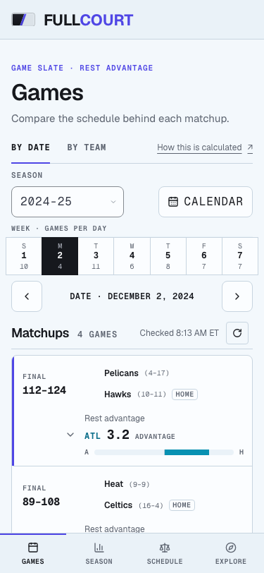
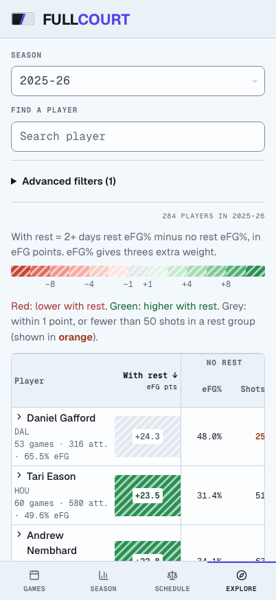
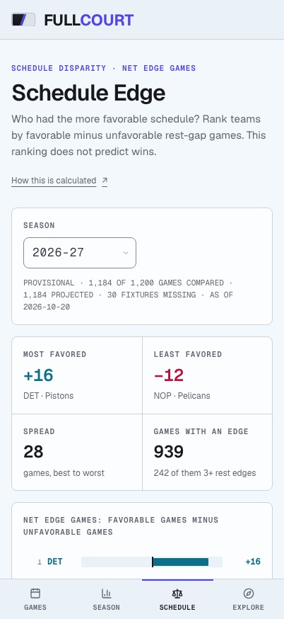
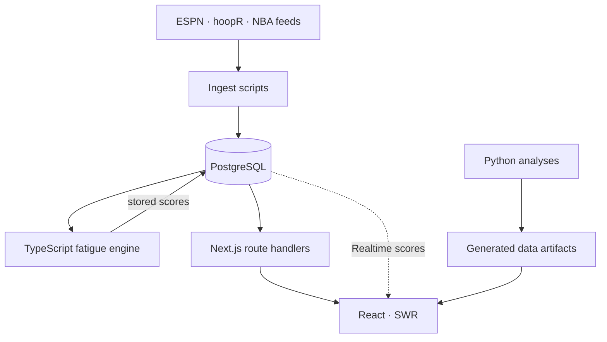

<div align="center">


# FullCourt

NBA rest and schedule findings, player shooting splits, and source-linked officiating reports.

**v1.1.3 · October 21, 2026** · [Release history](CHANGELOG.md)

[](https://github.com/mhju0/fullcourt/actions/workflows/ci.yml)
[](https://github.com/mhju0/fullcourt/actions/workflows/daily-update.yml)

[Open FullCourt](https://fullcourt.fyi) · [Read the methods](https://fullcourt.fyi/behind-the-data)

</div>

FullCourt scores each team's schedule load, compares the two teams in a matchup, and measures
how often the more-rested side won. It also examines playoff series, player shooting, shot
locations, missing rotation players, and officiating patterns.

Home court matters much more than rest. The regular-season model makes a call when the
more-rested team is at home; rested visitors are reported separately, and a neutral-site game
has no home team to call. Both win rates are
compared with their venue baselines. These are historical associations, not estimates of what
rest alone caused or a complete forecast of who will win.

The [Model Results page](https://fullcourt.fyi/analysis) carries the current rates and
sample sizes, split by gap size (small 0.5–3, medium 3–5, large 5+) and by five-season era. [Behind the Data](https://fullcourt.fyi/behind-the-data)
explains the calculations and publishes results that did not support a measurable effect.

The [engineering walkthrough source](src/app/how-it-was-built/page.tsx) explains the problem,
data flow, implementation tradeoffs and verification. About identifies the author and links
to that walkthrough in the application.

[Data status](https://fullcourt.fyi/data-status) separates coverage and available
refresh dates from database connectivity. Result studies open their latest usable published
season; selecting the new season explicitly keeps its Awaiting state until results are ready.
Selected views remain shareable through URLs and browser history.

## What you can examine

| Page | What it shows |
| --- | --- |
| [Games](https://fullcourt.fyi/games) | Browse matchups by season and date, and expand a game to inspect its schedule load. A rested team at home 3 to 5 points fresher is marked as a medium rest edge, 5 or more as a large one. Edges Ahead jumps to the upcoming games where the rested team is at home with the widest gaps. |
| [Season Report](https://fullcourt.fyi/season) | Published-season results against their home baseline, team rest records, and the completed games with the largest rest gaps the model called. Small samples are labeled. |
| [Schedule Edge](https://fullcourt.fyi/schedule) | Within-season rest-edge ranking, schedule worth, travel and workload, and the completed-game fatigue calendar. Details expand on demand. |
| [Explore](https://fullcourt.fyi/explore) | Seven basketball studies and their research sources, with compact cards and concise descriptions on phones. |
| [Home-Court Advantage](https://fullcourt.fyi/home-court) | Each season's home win rate beside the record of teams that were also more rested at home. |
| [Model Results](https://fullcourt.fyi/analysis) | Win rates for the rested team at home by gap size and by era, each compared with its venue baseline, the rested-visitor games reported separately, and a searchable game record filtered by gap size and rested side. |
| [Playoff Rest](https://fullcourt.fyi/playoffs) | Previous-round workload and a separate series probability model. Its probabilities improve on the historical base rate, while its overall accuracy is close to always choosing the home-court team. |
| [Player Shooting by Rest](https://fullcourt.fyi/shooting) | Effective field goal percentage on no rest versus 2–29 days off. Rest comes from each player's appearances. Single-season splits are noisy; career estimates use shrinkage toward the league mean. |
| [Expected Shot Value](https://fullcourt.fyi/shot-quality) | Expected shooting value by court location. The model does not observe defender distance, shot-clock pressure, or shot difficulty beyond location. |
| [Availability Cost](https://fullcourt.fyi/availability) | The estimated margin associated with a missing rotation player, controlling for team strength and schedule factors, with selectable annual readouts. Absences are identified after games, so this is not a lineup forecast. |
| [Officiating](https://fullcourt.fyi/officiating) | NBA Last Two Minute findings across 12 regular seasons (2014–15 through 2025–26), by team and call type, with the NBA’s verdicts inside each game. Covers selected close-game endings; earlier referee studies remain in the research archive. |

## Screenshots

Captured from [fullcourt.fyi](https://fullcourt.fyi) on 2026-10-21 at v1.1.0 (`9c313de8`);
[capture details and reproduction](docs/screenshots/README.md). Desktop images show historical
Games and the current published studies. Phone images use 375px and 402px Chromium viewports.
Physical iPhone, Safari and VoiceOver behavior remains unverified; live data can change.







<p>



</p>

On phones, Games puts matchups earlier, Schedule Edge leads with rankings, and Shooting keeps
its two rest splits and difference together in four columns. Home Court links graph selection
to the season readout, chart selections offer an explicit game-browsing action, and Expected
Shot Value compares models on one court while keeping the selected location.

## How the fatigue score works

The score combines recent workload, travel distance, time between games, schedule density,
altitude, extended road trips, and time away from the team's home time zone. Prior-game
overtime and margin affect workload; longer breaks reduce it. Travel is estimated from game
locations, not flight records.

Regular-season fatigue scores exclude playoff games and the 2019-20 Orlando bubble. Ordinary
games played before that season's suspension remain included. Schedule Edge excludes the
whole interrupted season from its team ranking because teams played unequal numbers of games.
Some inputs, including overtime and tip-off times, are unavailable in earlier seasons.

The [rest-advantage method](https://fullcourt.fyi/behind-the-data/rest-advantage)
documents the terms, coefficients, and tests. A weight-fitting study did not establish enough
improvement to replace the ratified model; its protocol and amendments are preserved in
[ADR 0006](docs/adr/0006-fatigue-weights-were-fitted-and-the-model-was-not-changed.md).

## Architecture



The fatigue engine in `src/lib/fatigue.ts` computes scores on the write path. Pages read the
stored results. Other analyses use dedicated queries or generated artifacts; player shooting,
availability, and Officiating use published artifacts. Officiating loads report details on demand.

| Layer | Implementation |
| --- | --- |
| Interface | Next.js, React, TypeScript, Tailwind CSS, Base UI, Recharts, SWR; CSS motion |
| Data access | Next.js route handlers, Zod, Drizzle ORM, node-postgres, Supabase PostgreSQL |
| Ingest and analysis | Python and TypeScript scripts; scikit-learn models run offline |
| Checks | Vitest, Playwright, Python contracts |
| Hosting and scheduled jobs | Vercel and GitHub Actions |

Start at the [documentation index](docs/README.md) for architecture, operations, reproducibility,
and release verification. No accounts or login are needed; selected views can be shared by URL.

## Run locally

Use the pnpm version pinned in `package.json`. CI uses Node 22 and Python 3.11.

```bash
pnpm install --frozen-lockfile
cp .env.example .env.local
# Set DATABASE_URL for a populated database.
pnpm dev
```

Open [localhost:3000](http://localhost:3000). Database-backed pages need populated data;
optional public Supabase settings enable live score updates.

The repository has no automatic database bootstrap. `src/lib/db/schema.ts` is deliberately
incomplete, and `drizzle/` contains manual SQL records. Do not run `drizzle-kit push` or
`generate`. Follow [Database](docs/DATABASE.md) and apply SQL manually in a dedicated database.

```bash
pnpm lint
pnpm typecheck
pnpm test:run
pnpm build
pnpm audit --prod
```

`pnpm test:e2e` starts its own server and needs a populated database. To test an existing
server, set `PLAYWRIGHT_BASE_URL`. Python requirements and contract-test commands are in
[Testing and CI/CD](docs/TESTING_AND_CICD.md).

## Repository map

| Directory | Contents |
| --- | --- |
| `src/app/` | Pages, metadata, and API routes |
| `src/components/` | Tables, charts, navigation, and shared controls |
| `src/lib/` | Fatigue model, database access, formatting, and analysis helpers |
| `src/hooks/` | Data loading, live scores, and browsing state |
| `scripts/` | Ingest, backfills, data generation, and maintenance |
| `ml/` | Offline analyses, reports, and pre-registrations |
| `src/data/`, `public/data/` | Generated analytics artifacts |
| `drizzle/` | SQL for manual application |
| `docs/` | [Current documentation index](docs/README.md), decisions, and clearly labeled research history |
| `anti-slop/` | Project-local review guidance; completed intermediate audits are retained in Git |

## Credits and license

Built by [Michael Ju](https://github.com/mhju0).

The interface bundles Geist and Geist Mono locally under the
[SIL Open Font License 1.1](src/app/fonts/Geist-Variable-OFL.txt);
[font provenance](src/app/fonts/Geist-Variable-PROVENANCE.md) records official sources and hashes.
The separate static Geist fonts used for social images retain their
[original license](src/app/fonts/OFL.txt).

Copyright (c) 2026 Michael Ju. All rights reserved. No license is granted for use, copying,
modification, or distribution of this code. The repository is public for portfolio review.
